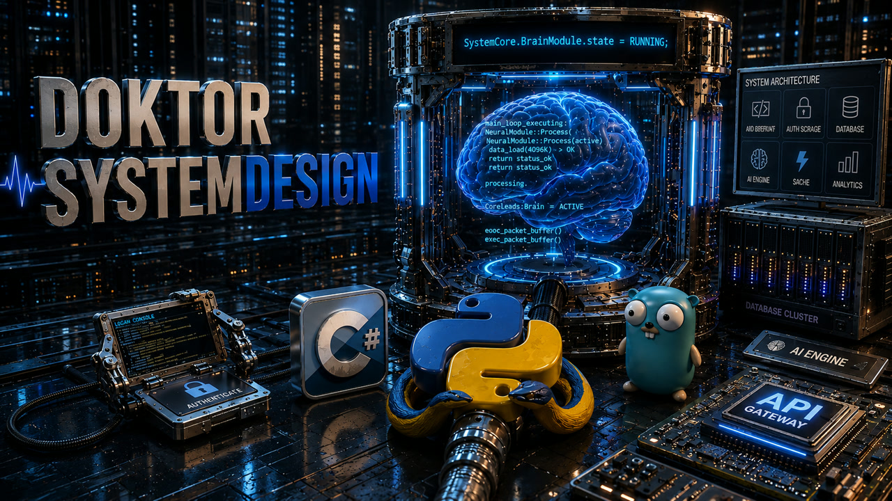

  

  
  
  

# Doktor System-Design

Padroes leves e guias de qualidade para iniciar e evoluir projetos de software com criterio, com ou sem apoio de IA.

## Para que serve

O Doktor ajuda equipes a responder perguntas recorrentes sem impor uma stack ou arquitetura universal:

- Como organizar o projeto para mudar com seguranca?
- Como criar uma interface bonita, responsiva, acessivel e coerente?
- Como proteger dados e contratos?
- O que medir para saber se o sistema esta rapido e saudavel?
- Como registrar decisoes, comandos e validacoes para continuar o trabalho?

O repositorio e progressivo: comece pelo guia minimo, abra os documentos ligados a tarefa e use receitas opcionais apenas quando um padrao especifico aparecer.

## Comece por aqui

| Se voce quer... | Abra |
|---|---|
| Entender o acervo e aplica-lo a um projeto novo | [Guia Rapido](docs/GUIA-RAPIDO-USO.md) |
| Dar contexto de trabalho a um agente de IA | [AGENTS.md](AGENTS.md) e [template AGENTS](templates/AGENTS-template.md) |
| Ver principios comuns de qualidade | [Guia Minimo](core/GUIA_MINIMO_QUALIDADE.md) |
| Escolher arquitetura e tecnologia | [Stack e Arquitetura](docs/STACK-E-ARQUITETURA.md) |
| Trabalhar UI, responsividade e identidade visual | [Design System Frontend](core/DESIGN_SYSTEM_FRONTEND.md) |
| Definir tokens e componentes compartilhados para um produto | [Template de Design System Frontend](templates/DESIGN-SYSTEM-FRONTEND-template.md) |
| Planejar performance | [Design System Performance](core/DESIGN_SYSTEM_PERFORMANCE.md) |
| Estudar sites, login, menus, dialogs e dashboards de referencia | [Estudo de Referencias Frontend](docs/ESTUDO-REFERENCIAS-FRONTEND.md) |
| Revisar fontes tecnicas atuais | [Referencias Tecnicas](docs/REFERENCIAS-TECNICAS.md) |
| Encontrar um guia especifico | [Indice Geral](docs/INDICE-GERAL.md) |

## Principios do sistema

- O problema, o publico e os contratos guiam a solucao.
- Use a menor arquitetura que mantenha mudancas, dados e operacao compreensiveis.
- Responsividade, acessibilidade e seguranca entram no desenho, nao como acabamento.
- Performance se mede nos fluxos importantes antes de otimizar.
- Regras e checklists devem caber no contexto do projeto.
- Fontes externas sao consultadas por tarefa e confirmadas antes de uso.
- Documentacao preserva comandos, decisoes, riscos e evidencia de validacao.

## Mapa do repositorio

| Pasta ou arquivo | Papel |
|---|---|
| AGENTS.md | Roteador de leitura para agentes |
| core/ | Guias de arquitetura, frontend, backend, API, seguranca, testes, performance e documentacao |
| docs/ | Criterios de adocao, referencias, identidade e operacao |
| guias/ | Receitas opcionais para funcionalidades especificas |
| templates/ | Arquivos iniciais copiaveis e adaptaveis |
| scripts/ | Instaladores e validadores do proprio repositorio |
| IA.md | Contexto vivo e historico tecnico |

Para os caminhos detalhados, use [docs/INDICE-GERAL.md](docs/INDICE-GERAL.md).

## Como aplicar

1. Descreva resultado, usuarios, restricoes e criterio de pronto.
2. Leia o guia minimo e o roteiro do tipo de tarefa.
3. Preserve a stack existente se ela atende; para projetos novos, escolha com base em equipe, produto, operacao e risco.
4. Registre decisoes caras de reverter e contratos publicos.
5. Valide o que importa para o risco e atualize a documentacao afetada.

Nem todo projeto precisa de todos os documentos, um design system visual completo ou um launcher proprio. Copie somente os artefatos que vao ser mantidos.

## Stack

Este acervo nao determina framework, banco ou provedor de deploy. [Stack e Arquitetura](docs/STACK-E-ARQUITETURA.md) apresenta perguntas e direcoes por contexto; exemplos sao opcoes, nao requisitos. Nao fixe versoes de ferramentas aqui: consulte a documentacao oficial e o lockfile do projeto.

## Referencias e atualizacao

[Referencias Tecnicas](docs/REFERENCIAS-TECNICAS.md) aponta para W3C, MDN, web.dev, OWASP e IETF. [Referencias Visuais e Movimento](docs/REFERENCIAS-VISUAIS-E-MOVIMENTO.md) ajuda a analisar design systems, componentes e movimento sem clonar a fonte. O [Estudo de Referencias Frontend](docs/ESTUDO-REFERENCIAS-FRONTEND.md) registra analises de sites editoriais e starters SaaS, com os limites e riscos encontrados.

Fontes e recomendacoes mudam. Reabra a fonte original quando a precisao atual importar e mantenha a data da ultima revisao.

## Validacao deste repositorio

~~~powershell
powershell -NoProfile -ExecutionPolicy Bypass -File scripts/validate-repo.ps1
powershell -NoProfile -ExecutionPolicy Bypass -File scripts/tests/run-tests.ps1
~~~

O validador e a suite de instaladores tambem rodam na GitHub Actions. Consulte [VALIDACAO-SCRIPTS.md](docs/VALIDACAO-SCRIPTS.md) para o escopo atual.

## Comunidade e licenca

O projeto e mantido por Andre Gustavo Melo da Silva, [AndreGustavoms](https://github.com/AndreGustavoms). Veja [CONTRIBUTING.md](CONTRIBUTING.md), [CODE_OF_CONDUCT.md](CODE_OF_CONDUCT.md), [SECURITY.md](SECURITY.md) e a licenca MIT. A atribuicao da origem esta em [NOTICE.md](NOTICE.md).
